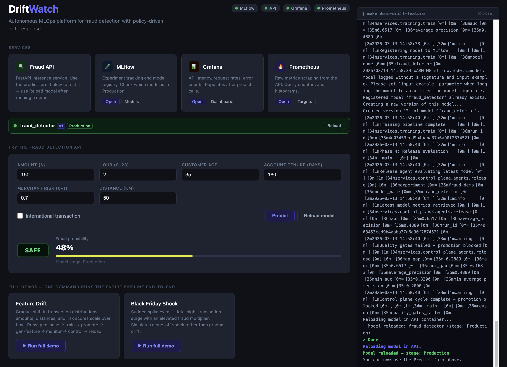

# DriftWatch

[](https://github.com/oleg-volkov-dev/DriftWatch/actions/workflows/ci.yml)
[](https://github.com/oleg-volkov-dev/DriftWatch/actions/workflows/docker-publish.yml)
[](LICENSE)

**A local MLOps demo of drift detection and policy-controlled model promotion**

DriftWatch uses synthetic online card payments to demonstrate drift detection, candidate evaluation, and model promotion. Its probabilities describe the simulation; they are not validated real-world fraud estimates.

---

## Overview

DriftWatch simulates a complete ML lifecycle where a triggered batch workflow decides whether to retrain and promote, with manual rollback available based on drift detection and quality gates.

### Key Features

- **Web Dashboard**: Browser UI at `localhost:8765` — run pipeline steps, launch demos, inspect the live model, and call the inference API without touching the terminal
- **Automated Drift Detection**: Monitors feature distribution drift using Evidently
- **Multi-Agent Control Plane**: Three specialized agents coordinate automated responses
  - **Sentinel**: Observes metrics and classifies incidents
  - **Planner**: Generates execution plans based on policies
  - **Release**: Enforces quality gates and safe deployments
- **Policy-as-Code**: All decisions constrained by versioned YAML policies
- **Full Observability**: MLflow tracking, Prometheus metrics, drift reports
- **Reproducible Demo Scenarios**: Pre-configured drift scenarios for testing

---

## Architecture

```
┌─────────────────┐
│  Synthetic Data │  ← Configurable drift injection
│    Generator    │
└────────┬────────┘
         │
         ▼
┌─────────────────┐     ┌──────────────┐
│  Training       │────▶│   MLflow     │
│  Pipeline       │     │   Registry   │
└─────────────────┘     └──────┬───────┘
                               │
                               ▼
                    ┌──────────────────┐
                    │  FastAPI Service │  ← Serves predictions
                    └──────────────────┘
                               │
         ┌─────────────────────┼─────────────────────┐
         │                     │                     │
         ▼                     ▼                     ▼
┌─────────────────┐   ┌──────────────┐    ┌──────────────┐
│   Monitoring    │   │  Prometheus  │    │   Grafana    │
│   (Evidently)   │   │   Metrics    │    │  Dashboard   │
└────────┬────────┘   └──────────────┘    └──────────────┘
         │
         ▼
┌─────────────────────────────────────────────────────────┐
│              Control Plane (Agents)                     │
│  ┌──────────┐   ┌─────────┐   ┌───────────────────┐   │
│  │ Sentinel │──▶│ Planner │──▶│ Release Agent     │   │
│  │ (Detect) │   │(Decide) │   │(Execute Safely)   │   │
│  └──────────┘   └─────────┘   └───────────────────┘   │
└─────────────────────────────────────────────────────────┘
```

---

## Tech Stack

- **ML**: scikit-learn, MLflow
- **API**: FastAPI, Uvicorn
- **Monitoring**: Evidently (drift), Prometheus, Grafana
- **Infrastructure**: Docker Compose
- **Language**: Python 3.11+

---

## Quick Start

### Prerequisites

- Docker & Docker Compose
- Python 3.11+ (for data generation)
- `pip install pyyaml numpy pandas structlog`

### 1. Start Services

```bash
make up
```

`make up` builds and starts the core services, then automatically opens the **DriftWatch dashboard** at `http://localhost:8765`. Everything else can be done from there. Data generation and pipeline commands build their job images before running, so updated code and scenario configs are included automatically. Unchanged Docker layers are reused.

Direct service links:
- **Dashboard**: http://localhost:8765
- **MLflow**: http://localhost:5000
- **API docs**: http://localhost:8000/docs
- **Prometheus**: http://localhost:9090
- **Grafana**: http://localhost:3000

### 2. Run a Complete Demo

```bash
make demo-drift-feature
```

With the default configuration, the baseline remains in Production because the
candidate does not improve predictions on held-out current transactions. Drift
triggers evaluation; it does not guarantee that retraining helps.

This will:
1. Generate baseline dataset (200k transactions)
2. Train and register model to MLflow
3. Promote model to Production stage
4. Generate drifted dataset (feature drift)
5. Detect drift using Evidently
6. Execute control plane response
7. Log all decisions to `shared/events/`

---

## Dashboard



`make up` opens the dashboard automatically. It can also be opened standalone with `make dashboard`.

**What you can do from the dashboard:**

- **Current model card** — always-visible status strip showing the loaded model name, version, and stage. Updates instantly after a reload.
- **Try the API** — send a prediction request with custom transaction features and see the fraud probability live.
- **Full demos** — one-click end-to-end runs (`demo-drift-feature`, `demo-black-friday`, `demo-card-testing`). Each demo generates data → trains → promotes → monitors → triggers the control plane → reloads the API automatically.
- **Pipeline steps** — run each stage individually in order:

```
[1 Gen Reference] → [2 Gen Current] → [3 Train] → [4 Promote]
[5 Monitor]       → [6 Control]     → [7 Reload]
```

Commands show a compact step-by-step progress panel. The final status explicitly
states when a candidate is rejected and which baseline remains in Production.
Each full demo first promotes a new baseline, then evaluates a separate scenario
candidate. The progress panel shows the baseline and candidate versions, and the
version loaded into the API at the final reload. Full logs are
available under **Technical output**, collapsed by default. Hide the panel and
reopen it with **Activity** without losing the running log. The model status card
updates after every reload so you can see the version change in real time.

### Grafana metrics

Open [DriftWatch — API & Drift](http://localhost:3000/d/driftwatch-fraud-api).

- **Online activity** comes from `/predict` calls. Generating datasets or running a
  demo does not send prediction traffic. Attempts include inference errors and
  unavailable-model responses; input-validation errors (422) are excluded.
- **Counts, error fraction, and score statistics** use the selected time range.
  Counts are Prometheus estimates that account for counter resets; they may be
  fractional. Empty fractions or percentiles mean there were no observations,
  or not enough scrapes. Graphs use an adaptive rolling window.
- **Flagged predictions** are model scores at or above the loaded model’s validation-selected threshold, not confirmed fraud.
  Score percentiles are histogram estimates, not measures of model accuracy.
  Execution latency excludes request validation, queuing, and network time.
- **Offline drift** shows the latest successfully published monitoring result at
  the selected end time. Check the result age and gateway health: batch values
  persist between runs. Severity measures the fraction of input features that
  drifted, excluding `is_fraud`. Critical-feature and model-quality alerts can
  trigger evaluation even when this ratio is low. Promotion still requires quality gates.
- **Health indicators** distinguish API reachability, a loaded model, and gateway
  reachability. Missing metrics are not treated as healthy zero values.

Dashboard files refresh automatically. After changes to metric exporters or data
source provisioning, rebuild the API with `docker compose up -d --build api`,
restart Grafana with `docker compose restart grafana`, and run `make monitor` to
publish the updated batch metrics. `make test-grafana` validates the dashboard's
actual queries against Prometheus fixtures; CI runs this check too.

---

## Demo Scenarios

### Feature Drift
Transaction amounts, distances, and merchant risk scores shift in one batch. The
fraud rule stays fixed: this is a change in input distributions, not a change in
what makes a given transaction risky. It does not simulate a gradual time series.
```bash
make demo-drift-feature
```

### Shock Event (Black Friday)
Larger payments during hours 20–23, higher merchant risk and international activity,
and a fraud multiplier in that window. The configured dataset is larger than the
baseline, but hours remain uniformly distributed; there is no within-window volume
surge. This scenario changes both feature distributions and the fraud rule.
```bash
make demo-black-friday
```

A retrained model replaces Production only if it passes the quality gates. The
default Black Friday scenario retains the baseline: the small improvement does
not justify a release.

### Shock Event (Card Testing)
A rare attack changes about 1% of rows into small payments with 10–30 prior
payment attempts in the last hour, at any time of day. Ordinary small payments
and ordinary overnight purchases are not automatically treated as attacks.
```bash
make demo-card-testing
```

Try $3 with 20 prior attempts, then change only the attempts to 1. The candidate
learns the small-payment/rapid-attempt pattern. Monitoring can trigger on outcome
or model-quality changes even when feature-distribution drift is small.

All supplied batches contain 200,000 transactions. Model fitting uses 60%,
threshold selection uses a separate 20%, and release evaluation uses the final
20%. Both candidate and incumbent are scored on that same release holdout.
Scenario seeds differ from the baseline seed.

| Scenario | Baseline AUC on current holdout | Candidate AUC | Default decision |
|---|---:|---:|---|
| Feature drift | 0.729 | 0.742 | Keep baseline |
| Black Friday | 0.728 | 0.733 | Keep baseline |
| Card testing | 0.945 | 0.951 | Promote candidate |

These are synthetic results, not real-world accuracy claims. AUC alone does not
decide a release: card testing reduces Brier probability error by about 60%,
whereas the other candidates do not meet the 2% relative improvement requirement.
Details are in `shared/events/release_result.json` and MLflow.

To apply the attack after an existing demo without training and promoting a fresh
baseline, run:
```bash
make gen-card-testing
make monitor
make control
make reload-api
```

---

## How It Works

### 1. Synthetic Data Generation
The default `baseline_fraud_rate: 0.002` targets **0.2%** expected fraud, not the
previous 35.7%. A fixed independent calibration population (50,000 rows, seed
2026) determines the intercept. The same fraud-logic configuration gives the same
intercept across seeds, batch sizes, and scenarios; current batches are never
recalibrated to hide drift. Realized rates vary with sampling and scenario changes.

The setting is synthetic **online card-payment attempts**. The 0.2% target and
feature weights are illustrative assumptions. For context, the
[EBA–ECB 2025 report, p. 19](https://www.ecb.europa.eu/press/intro/publications/pdf/ecb.ebaecb202512.en.pdf)
reports 0.068% fraud by count for remote card payments in 2024; a
[ULB/Worldline research cohort](https://fraud-detection-handbook.github.io/fraud-detection-handbook/Chapter_3_GettingStarted/Baseline_RealWorldData.html)
reported about 0.25% for Belgian e-commerce in 2018. These populations are not
identical to this simulation and do not validate its individual probabilities.

Seven inputs keep the model small:

- Amount and local transaction hour.
- `payment_attempts_1h`: prior attempts from the same session/device, including
  declines. This replaces customer age. It is a generated history summary;
  the demo does not simulate a ledger or collect device information.
- Account tenure; its synthetic contribution decays as `exp(-days / 180)`.
- Merchant risk index (0–1): a synthetic reputation signal, **not a probability**.
- Distance between the payment IP location and the customer's usual IP location.
  This is an approximate synthetic signal, not distance to an online merchant.
- International status.

Risk uses bounded amount/distance effects and a rapid-attempt indicator (10 or
more attempts). Card testing adds a small-payment interaction ($10 or less).
These thresholds and coefficients are demo choices, not proven fraud rules.
The research handbook's [simulator](https://fraud-detection-handbook.github.io/fraud-detection-handbook/Chapter_3_GettingStarted/SimulatedDataset.html)
is useful background on rare labels and controlled fraud scenarios.

The dashboard starts with an ordinary $20 payment, one prior attempt, and shows
**Flagged / Not flagged**, a synthetic probability to three decimal places, and
the model's flagging threshold. Each model selects its threshold on validation
data by minimizing `false positives + 100 × false negatives`. The cost ratio is
illustrative, not monetary. MLflow logs the threshold and release-holdout precision,
recall, and flagged fraction. A threshold changes the decision, not the probability.
Calibration against synthetic labels is not evidence of real-world calibration.

**Existing installations must regenerate data and retrain:** the old age-based
models and CSVs are incompatible with the new attempt-count input. Rebuild the
API, then run a full demo to publish and load a fresh baseline. Until then the
API may report that no compatible model is loaded. Do not roll back to an old-schema
model.

```bash
docker compose up -d --build api
make demo-drift-feature
```

### 2. Drift Detection
Evidently analyzes reference vs current data:
- Calculates drift ratio (% of features drifted)
- Classifies severity: none/low/medium/high
- Generates HTML report + JSON summary

Monitoring also loads the registered Production model once, pins its version,
and evaluates that same model on reference and current data. The JSON summary
includes precision and recall at the evaluated model's saved threshold, ROC AUC, average
precision, Brier score, log loss, ten-bin calibration error and reliability-bin
data, plus observed fraud prevalence. Quality metrics are overall only: hourly
slices have too few fraud examples. Feature-drift HTML is a separate report.

The `monitoring_policy` section of `services/control_plane/policies/promotion.yaml`
controls critical features, minimum label counts, and alert thresholds. Defaults:

- Drift in amount, prior attempts, or merchant risk raises an alert even when
  only one feature changes.
- At least 100 observed labels are required for outcome metrics, and at least
  20 examples of **each class** for model-quality metrics in each window.
- Precision/recall drops over 0.10, AUC drops over 0.05, Brier increases over
  0.002, calibration-error increases over 0.005, or fraud-rate changes over
  0.002 raise alerts. These are absolute changes, not significance tests.

`severity` continues to describe feature drift alone; `incident_severity` also
accounts for critical-feature, outcome, and model-quality alerts. Any alert raises
the incident to at least medium. Sentinel passes this severity to the existing
policy-driven planner; retraining never bypasses release gates. If current labels
are incomplete or have fewer than five examples of either class, the planner
records `await_labels`. Promotion separately requires 50 examples of each class
in the release holdout; tiny batches cannot authorize a release.

The label column is optional and may contain missing values for delayed labels.
Only labelled rows contribute to outcome/quality metrics, and label coverage is
reported. Undefined metrics (such as recall without positives) are `null`, not
healthy zeros. An unavailable model is explicitly reported; feature and observed
outcome monitoring still run. Invalid labels or model probabilities fail the job.

These comparisons monitor the registered Production model, which may differ from
an API instance that has not reloaded. Reference data reused from training can
give optimistic reference metrics; use independent labelled reference/current
windows for meaningful quality evaluation. Partial labels can also be biased.
Candidate-versus-incumbent release evaluation is a separate concern.

Prometheus exports `monitoring_incident_severity`, `monitoring_alert_count`,
per-alert `monitoring_alert`, `monitoring_quality{window,scope,metric}`,
`monitoring_quality_available`, `monitoring_label_coverage`, and
`monitoring_labeled_rows`. Scope is `overall`.
Undefined metric series are omitted, and each push replaces the previous batch.
Grafana's labelled-outcomes section shows combined severity, active alerts,
quality availability, label coverage, overall quality, and probability errors. Check the result-age panel because these are batch observations.

### 3. Control Plane Execution

**Sentinel** reads monitoring summary:
```json
{
  "incident_type": "drift",
  "severity": "medium",
  "recommended_action": "retrain_and_evaluate"
}
```

**Planner** checks policies:
```yaml
drift_policy:
  on_medium:
    action: retrain_and_evaluate
```

**Release Agent** enforces quality gates:
```yaml
quality_gates:
  min_auc: 0.65
  min_average_precision: 0.01
  min_evaluation_class_rows: 50

production_comparison:
  max_auc_drop: 0.01
  max_average_precision_drop: 0.01
  min_relative_brier_improvement: 0.02
```

Candidates must pass the minimum AUC/AP and holdout-support gates, and reduce
Brier score (mean squared probability error) by at least **2% relative** to
Production on the same holdout. AUC and average precision may each drop by at
most 0.01. Relative Brier improvement replaces the old absolute 0.002 gate, which
was too large for many rare-event batches. Missing comparison evidence or a
changed Production version blocks promotion. These are demo tolerances, not
statistical significance tests. With no incumbent, the absolute gates still apply.

Release evaluation uses the registered version belonging to the current training run. The API serves only Production models; failed reloads return HTTP 503 and preserve the working model. `make rollback` checks that its manifest still matches Production, restores the previous version, and reloads the API. A successful rollback consumes its manifest.

---

## Project Structure

```
driftwatch/
├── data/
│   └── generator/          # Synthetic fraud data generator
│       ├── generate.py
│       └── config/         # Drift scenario configs
├── services/
│   ├── api/                # FastAPI inference service
│   ├── training/           # Model training pipeline
│   ├── monitoring/         # Evidently drift detection
│   └── control_plane/      # Multi-agent orchestration
│       ├── agents/
│       │   ├── sentinel.py
│       │   ├── planner.py
│       │   └── release.py
│       ├── policies/
│       │   └── promotion.yaml
│       └── runner.py
├── infra/
│   ├── dashboard/          # Web dashboard (server.py serves dashboard.html)
│   ├── prometheus/
│   └── grafana/
├── shared/                 # Runtime artifacts (gitignored)
│   ├── data/               # Generated datasets
│   ├── reports/            # Drift reports
│   └── events/             # Agent decision logs
├── docker-compose.yml
├── Makefile
└── README.md
```

---

## Policy Configuration

All automated decisions are governed by `services/control_plane/policies/promotion.yaml`:

```yaml
quality_gates:
  min_auc: 0.65
  min_average_precision: 0.01
  min_evaluation_class_rows: 50

production_comparison:
  max_auc_drop: 0.01
  max_average_precision_drop: 0.01
  min_relative_brier_improvement: 0.02

drift_policy:
  on_none:
    action: noop
  on_low:
    action: noop
  on_medium:
    action: retrain_and_evaluate
  on_high:
    action: retrain_and_evaluate

release_policy:
  promote_if_quality_gates_pass: true
  promote_stage: Production
```

---

## Available Commands

```bash
# Infrastructure
make up              # Start services + open dashboard
make down            # Stop all services
make dashboard       # Open dashboard without restarting services
make logs            # Tail all logs
make api-logs        # Tail API logs only

# Data Generation
make gen-base        # Generate reference dataset
make gen-feature     # Generate feature drift current dataset
make gen-blackfriday # Generate Black Friday shock current dataset
make gen-card-testing # Generate card-testing attack current dataset

# ML Pipeline
make train           # Train model and register to MLflow
make promote-prod    # Promote latest model to Production
make monitor         # Run Evidently drift detection
make control         # Execute control plane (sentinel → planner → release)
make reload-api      # Hot-reload Production model in the API

# End-to-End Demos
make demo-drift-feature   # Full pipeline: feature drift scenario
make demo-black-friday    # Full pipeline: Black Friday shock scenario
make demo-card-testing    # Full pipeline: card-testing attack scenario

# Development (CI/CD)
make setup-dev       # Install dev dependencies
make install-hooks   # Install pre-commit hooks
make format          # Format code
make lint            # Run linting
make test            # Run tests
make check           # Run all checks
make ci-local        # Simulate CI pipeline
```

---

The card-testing scenario selects 1% of transactions across all hours, scales
amounts to 5% (clipped to $1–$10), sets 10–30 prior attempts, and adds 4 to their
fraud log-odds. Unselected rows keep their features and labels. Configure
`affected_fraction`, `spike_hours`, `amount_scale`, and `attack_log_odds` in the
scenario YAML; `affected_fraction: 0` disables the attack. These are controlled
synthetic changes, not a claim about the prevalence or success of real attacks.

## Development & CI/CD

Keep personal notes and scratch output in `.local/` (ignored by Git). Generated
datasets/reports, model artifacts, caches, coverage files, local environment
files, and assistant state are excluded from commits and Docker build contexts.
Source, tests, CI configuration, and reusable project documentation belong in Git.

This project uses automated quality checks and testing:

**Setup (one-time):**
```bash
make setup-dev      # Install pytest, ruff, mypy, etc.
make install-hooks  # Install git pre-commit hooks
```

**Before committing:**
```bash
make format  # Auto-fix imports and style with ruff
make lint    # Check with Ruff & mypy
make test    # Run tests with coverage (failures return nonzero)
```

The test suite includes an isolated MLflow/Evidently lifecycle test covering generation, training, drift detection, promotion, inference, and rollback. Install both requirements files to run it. Lightweight environments without MLflow use dependency stubs for unit tests and skip this integration test.

Pre-commit hooks run automatically on `git commit`. GitHub Actions run on every push:
- Code formatting validation
- Linting and type checking
- Test suite with coverage
- Docker image builds

---

## Example: Inspecting Results

After running a demo:

```bash
# View drift summary
cat shared/reports/monitoring_summary.json

# View Sentinel's incident report
cat shared/events/sentinel_report.json

# View Planner's execution plan
cat shared/events/execution_plan.json

# View Release decision
cat shared/events/release_result.json

# Open drift report in browser
open shared/reports/drift_report.html
```

---

## License

MIT

---

## Acknowledgments

Built to demonstrate MLOps patterns with synthetic fraud scenarios. Not intended for actual fraud detection use.
