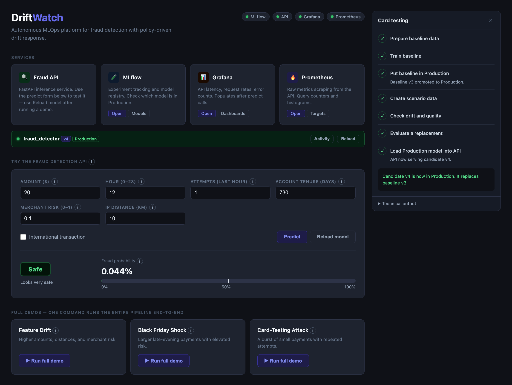

# DriftWatch

[](https://github.com/oleg-volkov-dev/DriftWatch/actions/workflows/ci.yml)
[](https://github.com/oleg-volkov-dev/DriftWatch/actions/workflows/docker-publish.yml)
[](LICENSE)

DriftWatch is a local MLOps demo built around synthetic card payments. It detects
changes in data and model quality, trains a candidate, and promotes it only when
it passes a release policy. A browser dashboard runs the workflow and shows which
model the API is serving.

The probabilities describe the simulation. They are not validated real-world
fraud estimates.

## Quick start

You need Docker with Compose, Make, and Python 3.11. The dashboard uses Python's
standard library; data generation and ML jobs run in Docker, so no host Python
packages are needed for the demo.

From the repository root:

```bash
make up
make demo-drift-feature
```

`make up` builds the core services and opens [the dashboard](http://localhost:8765).
The browser shortcut uses macOS `open`. On Linux, start Compose and the dashboard
server directly, then open that URL yourself:

```bash
docker compose up -d --build mlflow pushgateway prometheus grafana api
python3 infra/dashboard/server.py
```

Wait for MLflow to respond before starting a demo. Each full demo generates a
baseline, trains and promotes it, generates scenario data, runs monitoring and
the control plane, then reloads the API. The first build can take a few minutes.
Job images rebuild before each run, reusing unchanged Docker layers.

| Service | Address |
|---|---|
| Dashboard | http://localhost:8765 |
| MLflow runs and registry | http://localhost:5000 |
| Inference API docs | http://localhost:8000/docs |
| Grafana | http://localhost:3000 |
| Prometheus | http://localhost:9090 |

To stop containers while keeping registered models, use `docker compose stop`.
**`make down` removes containers and volumes, including MLflow models and run
history.** It also stops the dashboard process started by Make. Generated files
under `shared/` remain on disk.

## Try a scenario

| Command | What changes | Expected result with supplied configs |
|---|---|---|
| `make demo-drift-feature` | Amount, distance, and merchant risk distributions | Keep baseline |
| `make demo-black-friday` | Larger evening payments and a changed fraud rule | Keep baseline |
| `make demo-card-testing` | Small payments with repeated attempts in about 1% of rows | Promote candidate |

All supplied batches contain 200,000 transactions. Drift triggers evaluation;
it does not guarantee that retraining helps. Both models are evaluated on the
same held-out current transactions. A release needs at least 2% relative
improvement in Brier score, which measures probability error, along with the
other [quality gates](docs/MODEL.md#monitoring-and-release).

Each full demo promotes a fresh baseline before evaluating its candidate. To
apply a scenario to the existing Production model, use the individual steps in
[Operations](docs/OPERATIONS.md#pipeline-commands).

## Dashboard



The dashboard shows service status, the loaded model version, and a prediction
form. Run a full demo or an individual pipeline step from the same page. The
progress panel explains the release decision; detailed logs sit under
**Technical output**. **Activity** reopens the panel while a job runs.

The prediction display uses the model's probability directly. Its **Safe/Fraud**
summary switches at 50%; the API's `is_fraud` flag uses a separately trained
review threshold. [Model behavior](docs/MODEL.md#predictions-and-thresholds)
explains the difference.

## How the pieces fit

```text
Generator → reference/current CSVs → Monitoring → Sentinel → Planner
                 │                       │                    │
                 ▼                       ▼                    ▼
              Training              HTML + JSON       Train candidate → Release
                 │                                            │
                 └─────────────── MLflow registry ←────────────┘
                                        │
                                    API reload → Predictions
```

Sentinel, Planner, and Release are ordinary Python components driven by a YAML
policy. The workflow runs when invoked; there is no background retraining loop
or LLM dependency. Prometheus scrapes the API and monitoring's Pushgateway
metrics, and Grafana displays them.

| Path | Purpose |
|---|---|
| `data/generator/` | Synthetic data and scenario configurations |
| `services/common/` | Shared feature transforms, estimator, and logging |
| `services/training/`, `services/api/` | Model fitting, registry access, and inference |
| `services/monitoring/`, `services/control_plane/` | Drift, quality checks, and release decisions |
| `dashboard.html`, `infra/dashboard/` | Browser UI and local server |
| `infra/grafana/`, `infra/prometheus/` | Metrics configuration |
| `tests/` | Unit, dashboard, and lifecycle regression tests |
| `shared/` | Generated data, reports, and decision files; ignored by Git |

## Guides

- [Operations](docs/OPERATIONS.md): commands, API example, configuration, metrics, and troubleshooting.
- [Model and release behavior](docs/MODEL.md): synthetic assumptions, scenarios, thresholds, and policy gates.
- [Development](docs/DEVELOPMENT.md): environment setup, tests, and CI coverage.
- [Logging](docs/LOGGING.md): reading and adding structured logs.

Licensed under the [MIT License](LICENSE).
