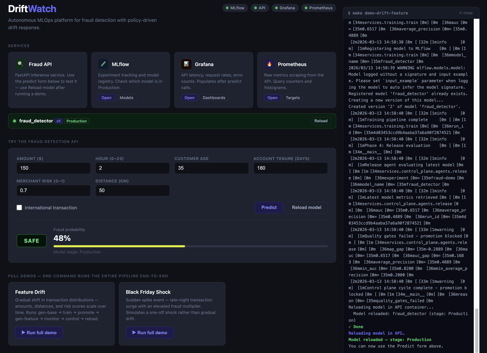

# DriftWatch

[](https://github.com/oleg-volkov-dev/DriftWatch/actions/workflows/ci.yml)
[](https://github.com/oleg-volkov-dev/DriftWatch/actions/workflows/docker-publish.yml)
[](LICENSE)

**Autonomous MLOps platform for fraud detection with policy-driven drift response**

A production-grade MLOps demonstration that automatically detects, evaluates, and responds to model drift using a multi-agent control plane. Built with synthetic fraud data to showcase real-world ML reliability patterns.

---

## Overview

DriftWatch simulates a complete ML lifecycle where models monitor themselves and autonomously decide when to retrain, deploy, or rollback based on drift detection and quality gates.

### Key Features

- **Web Dashboard**: Browser UI at `localhost:8765` — run pipeline steps, launch demos, inspect the live model, and call the inference API without touching the terminal
- **Automated Drift Detection**: Monitors feature distribution drift using Evidently
- **Multi-Agent Control Plane**: Three specialized agents coordinate automated responses
  - **Sentinel**: Observes metrics and classifies incidents
  - **Planner**: Generates execution plans based on policies
  - **Release**: Enforces quality gates and safe deployments
- **Policy-as-Code**: All decisions constrained by versioned YAML policies
- **Full Observability**: MLflow tracking, Prometheus metrics, drift reports
- **Reproducible Demo Scenarios**: Pre-configured drift scenarios for testing

---

## Architecture

```
┌─────────────────┐
│  Synthetic Data │  ← Configurable drift injection
│    Generator    │
└────────┬────────┘
         │
         ▼
┌─────────────────┐     ┌──────────────┐
│  Training       │────▶│   MLflow     │
│  Pipeline       │     │   Registry   │
└─────────────────┘     └──────┬───────┘
                               │
                               ▼
                    ┌──────────────────┐
                    │  FastAPI Service │  ← Serves predictions
                    └──────────────────┘
                               │
         ┌─────────────────────┼─────────────────────┐
         │                     │                     │
         ▼                     ▼                     ▼
┌─────────────────┐   ┌──────────────┐    ┌──────────────┐
│   Monitoring    │   │  Prometheus  │    │   Grafana    │
│   (Evidently)   │   │   Metrics    │    │  Dashboard   │
└────────┬────────┘   └──────────────┘    └──────────────┘
         │
         ▼
┌─────────────────────────────────────────────────────────┐
│              Control Plane (Agents)                     │
│  ┌──────────┐   ┌─────────┐   ┌───────────────────┐   │
│  │ Sentinel │──▶│ Planner │──▶│ Release Agent     │   │
│  │ (Detect) │   │(Decide) │   │(Execute Safely)   │   │
│  └──────────┘   └─────────┘   └───────────────────┘   │
└─────────────────────────────────────────────────────────┘
```

---

## Tech Stack

- **ML**: scikit-learn, MLflow
- **API**: FastAPI, Uvicorn
- **Monitoring**: Evidently (drift), Prometheus, Grafana
- **Infrastructure**: Docker Compose
- **Language**: Python 3.11+

---

## Quick Start

### Prerequisites

- Docker & Docker Compose
- Python 3.11+ (for data generation)
- `pip install pyyaml numpy pandas structlog`

### 1. Start Services

```bash
make up
```

`make up` builds and starts the core services, then automatically opens the **DriftWatch dashboard** at `http://localhost:8765`. Everything else can be done from there. Data generation and pipeline commands build their job images before running, so updated code and scenario configs are included automatically. Unchanged Docker layers are reused.

Direct service links:
- **Dashboard**: http://localhost:8765
- **MLflow**: http://localhost:5000
- **API docs**: http://localhost:8000/docs
- **Prometheus**: http://localhost:9090
- **Grafana**: http://localhost:3000

### 2. Run a Complete Demo

```bash
make demo-drift-feature
```

With the default configuration, the baseline remains in Production because the
candidate does not improve predictions on held-out current transactions. Drift
triggers evaluation; it does not guarantee that retraining helps.

This will:
1. Generate baseline dataset (5k transactions)
2. Train and register model to MLflow
3. Promote model to Production stage
4. Generate drifted dataset (feature drift)
5. Detect drift using Evidently
6. Execute control plane response
7. Log all decisions to `shared/events/`

---

## Dashboard



`make up` opens the dashboard automatically. It can also be opened standalone with `make dashboard`.

**What you can do from the dashboard:**

- **Current model card** — always-visible status strip showing the loaded model name, version, and stage. Updates instantly after a reload.
- **Try the API** — send a prediction request with custom transaction features and see the fraud probability live.
- **Full demos** — one-click end-to-end runs (`demo-drift-feature`, `demo-black-friday`, `demo-card-testing`). Each demo generates data → trains → promotes → monitors → triggers the control plane → reloads the API automatically.
- **Pipeline steps** — run each stage individually in order:

```
[1 Gen Reference] → [2 Gen Current] → [3 Train] → [4 Promote]
[5 Monitor]       → [6 Control]     → [7 Reload]
```

Commands show a compact step-by-step progress panel. The final status explicitly
states when a candidate is rejected and which baseline remains in Production.
Each full demo first promotes a new baseline, then evaluates a separate scenario
candidate. The progress panel shows the baseline and candidate versions, and the
version loaded into the API at the final reload. Full logs are
available under **Technical output**, collapsed by default. Hide the panel and
reopen it with **Activity** without losing the running log. The model status card
updates after every reload so you can see the version change in real time.

### Grafana metrics

Open [DriftWatch — API & Drift](http://localhost:3000/d/driftwatch-fraud-api).

- **Online activity** comes from `/predict` calls. Generating datasets or running a
  demo does not send prediction traffic. Attempts include inference errors and
  unavailable-model responses; input-validation errors (422) are excluded.
- **Counts, error fraction, and score statistics** use the selected time range.
  Counts are Prometheus estimates that account for counter resets; they may be
  fractional. Empty fractions or percentiles mean there were no observations,
  or not enough scrapes. Graphs use an adaptive rolling window.
- **Flagged predictions** are model scores at or above 0.5, not confirmed fraud.
  Score percentiles are histogram estimates, not measures of model accuracy.
  Execution latency excludes request validation, queuing, and network time.
- **Offline drift** shows the latest successfully published monitoring result at
  the selected end time. Check the result age and gateway health: batch values
  persist between runs. Severity measures the fraction of input features that
  drifted, excluding `is_fraud`. Critical-feature and model-quality alerts can
  trigger evaluation even when this ratio is low. Promotion still requires quality gates.
- **Health indicators** distinguish API reachability, a loaded model, and gateway
  reachability. Missing metrics are not treated as healthy zero values.

Dashboard files refresh automatically. After changes to metric exporters or data
source provisioning, rebuild the API with `docker compose up -d --build api`,
restart Grafana with `docker compose restart grafana`, and run `make monitor` to
publish the updated batch metrics. `make test-grafana` validates the dashboard's
actual queries against Prometheus fixtures; CI runs this check too.

---

## Demo Scenarios

### Feature Drift
Transaction amounts, distances, and merchant risk scores shift in one batch. The
fraud rule stays fixed: this is a change in input distributions, not a change in
what makes a given transaction risky. It does not simulate a gradual time series.
```bash
make demo-drift-feature
```

### Shock Event (Black Friday)
Larger payments during hours 20–23, higher merchant risk and international activity,
and a fraud multiplier in that window. The configured dataset is larger than the
baseline, but hours remain uniformly distributed; there is no within-window volume
surge. This scenario changes both feature distributions and the fraud rule.
```bash
make demo-black-friday
```

After either demo completes, try the predict form with `Hour = 22` and `Amount = 1500`. A retrained model replaces Production only if it passes the configured quality gates; a blocked release keeps the existing model and predictions.

### Shock Event (Card Testing)
Small overnight payments with elevated fraud probabilities during hours 00–05,
mixed with ordinary overnight traffic. By default half of transactions in this
window are selected for the attack.
```bash
make demo-card-testing
```

With the default config, monitoring detects drift in transaction amounts (one of
seven features), giving `low` feature-drift severity. Amount is a configured
critical feature, so the combined incident severity is at least `medium` and the
control plane evaluates retraining. Outcome and model-quality changes can raise
additional alerts. A replacement still has to pass the release quality gates.
With the supplied configurations, Black Friday and card testing both promote an
improved candidate. Both models are scored on the same 20% holdout from the current
batch, excluded from candidate training. Scenario seeds differ from the baseline
seed to avoid reusing baseline training transactions during evaluation.

| Scenario | Baseline AUC on current holdout | Candidate AUC | Default decision |
|---|---:|---:|---|
| Feature drift | 0.712 | 0.706 | Keep baseline |
| Black Friday | 0.746 | 0.761 | Promote candidate |
| Card testing | 0.708 | 0.767 | Promote candidate |

These are deterministic demo results, not real-world fraud performance claims.
The release also checks probability error and average precision; details are in
`shared/events/release_result.json` and the training run in MLflow.

To apply the attack after an existing demo without training and promoting a fresh
baseline, run:
```bash
make gen-card-testing
make monitor
make control
make reload-api
```

---

## How It Works

### 1. Synthetic Data Generation
Deterministic fraud dataset with configurable drift:
- **Features**: transaction_amount, customer_age, merchant_risk, geo_distance, etc.
- **Drift Types**: Feature distribution shifts, shock events
- **Config-driven**: YAML files control drift parameters

New accounts have extra synthetic risk of
`new_account_weight * exp(-account_tenure_days / 180)` in the fraud score.
The supplied scenarios use weight `1.2`; set it to `0` to make tenure neutral.
Omitting it in a custom config also defaults to `0`. Customer age remains a neutral
feature. These are demo assumptions, not empirically established fraud rules.

High amounts use a fixed threshold of $150 and distance risk uses
`min(geo_distance_km / 200, 1)`. These scales do not change with batch composition.
Training uses the same bounded amount/distance signals and tenure decay, and
encodes each hour separately. A small-payment/overnight interaction (amount <= $10,
hour 00–05) lets it learn attack patterns without assigning the same extra risk to
every overnight purchase. The dashboard displays probabilities to one decimal
place. The default form (2 AM, merchant risk 0.6, $150, 500 km) is intentionally
risky; try noon, $50, merchant risk 0.1, 10 km, and tenure 730 days for a lower-risk
comparison. Very high scores can still be appropriate for attack-like inputs.

Generator or preprocessing edits require new data and a newly trained model.
For existing installations, rebuild the API first so it contains the new tenure
transforms, then run a demo to regenerate data, train, promote the baseline, and
reload:

```bash
docker compose up -d --build api
make demo-drift-feature
```

### 2. Drift Detection
Evidently analyzes reference vs current data:
- Calculates drift ratio (% of features drifted)
- Classifies severity: none/low/medium/high
- Generates HTML report + JSON summary

Monitoring also loads the registered Production model once, pins its version,
and evaluates that same model on reference and current data. The JSON summary
includes precision and recall at the API's 0.5 threshold, ROC AUC, average
precision, Brier score, log loss, ten-bin calibration error and reliability-bin
data, plus observed fraud prevalence. Metrics are calculated overall and by
transaction hour. Feature-drift HTML remains a separate distribution report.

The `monitoring_policy` section of `services/control_plane/policies/promotion.yaml`
controls critical features, minimum label counts, and alert thresholds. Defaults:

- Drift in amount, merchant risk, or international status raises an alert even
  when only one feature changes.
- At least 100 observed labels are required in **each** compared window, both
  overall and for each hourly slice. Below this, metrics are marked unavailable.
- Precision/recall drops over 0.10, AUC drops over 0.05, Brier/calibration-error
  increases over 0.05, or absolute fraud-rate changes over 0.10 raise alerts.
  These are absolute changes (0.10 means ten percentage points), not relative
  percentages. They are demo thresholds, not statistical significance tests.

`severity` continues to describe feature drift alone; `incident_severity` also
accounts for critical-feature, outcome, and model-quality alerts. Any alert raises
the incident to at least medium. Sentinel passes this severity to the existing
policy-driven planner; retraining never bypasses release gates. If current labels
are incomplete or contain only one class, the planner records `await_labels`.

The label column is optional and may contain missing values for delayed labels.
Only labelled rows contribute to outcome/quality metrics, and label coverage is
reported. Undefined metrics (such as recall without positives) are `null`, not
healthy zeros. An unavailable model is explicitly reported; feature and observed
outcome monitoring still run. Invalid labels or model probabilities fail the job.

These comparisons monitor the registered Production model, which may differ from
an API instance that has not reloaded. Reference data reused from training can
give optimistic reference metrics; use independent labelled reference/current
windows for meaningful quality evaluation. Partial labels can also be biased.
Candidate-versus-incumbent release evaluation is a separate concern.

Prometheus exports `monitoring_incident_severity`, `monitoring_alert_count`,
per-alert `monitoring_alert`, `monitoring_quality{window,scope,metric}`,
`monitoring_quality_available`, `monitoring_label_coverage`, and
`monitoring_labeled_rows`. Scope is `overall` or `hour_0` through `hour_23`.
Undefined metric series are omitted, and each push replaces the previous batch.
Grafana's labelled-outcomes section shows combined severity, active alerts,
quality availability, label coverage, overall quality, probability errors, and
recall by hour. Check the result-age panel because these are batch observations.

### 3. Control Plane Execution

**Sentinel** reads monitoring summary:
```json
{
  "incident_type": "drift",
  "severity": "medium",
  "recommended_action": "retrain_and_evaluate"
}
```

**Planner** checks policies:
```yaml
drift_policy:
  on_medium:
    action: retrain_and_evaluate
```

**Release Agent** enforces quality gates:
```yaml
quality_gates:
  min_auc: 0.65
  min_average_precision: 0.20

production_comparison:
  max_auc_drop: 0.01
  max_average_precision_drop: 0.01
  min_brier_improvement: 0.002
```

Candidates must pass the absolute minimums and improve Brier score (mean squared
probability error, lower is better) by at least 0.002 against Production on the same
holdout. AUC and average precision may each drop by at most 0.01. These tolerances
are demo policy choices, not statistical significance tests. The earlier 0.82 AUC
floor rejected every default candidate despite useful gains on the shock scenarios.
Missing comparison metrics or a changed Production version block promotion.
When no Production model exists, only the absolute gates apply.

Release evaluation uses the registered version belonging to the current training run. The API serves only Production models; failed reloads return HTTP 503 and preserve the working model. `make rollback` checks that its manifest still matches Production, restores the previous version, and reloads the API. A successful rollback consumes its manifest.

---

## Project Structure

```
driftwatch/
├── data/
│   └── generator/          # Synthetic fraud data generator
│       ├── generate.py
│       └── config/         # Drift scenario configs
├── services/
│   ├── api/                # FastAPI inference service
│   ├── training/           # Model training pipeline
│   ├── monitoring/         # Evidently drift detection
│   └── control_plane/      # Multi-agent orchestration
│       ├── agents/
│       │   ├── sentinel.py
│       │   ├── planner.py
│       │   └── release.py
│       ├── policies/
│       │   └── promotion.yaml
│       └── runner.py
├── infra/
│   ├── dashboard/          # Web dashboard (server.py serves dashboard.html)
│   ├── prometheus/
│   └── grafana/
├── shared/                 # Runtime artifacts (gitignored)
│   ├── data/               # Generated datasets
│   ├── reports/            # Drift reports
│   └── events/             # Agent decision logs
├── docker-compose.yml
├── Makefile
└── README.md
```

---

## Policy Configuration

All automated decisions are governed by `services/control_plane/policies/promotion.yaml`:

```yaml
quality_gates:
  min_auc: 0.65
  min_average_precision: 0.20

production_comparison:
  max_auc_drop: 0.01
  max_average_precision_drop: 0.01
  min_brier_improvement: 0.002

drift_policy:
  on_none:
    action: noop
  on_low:
    action: noop
  on_medium:
    action: retrain_and_evaluate
  on_high:
    action: retrain_and_evaluate

release_policy:
  promote_if_quality_gates_pass: true
  promote_stage: Production
```

---

## Available Commands

```bash
# Infrastructure
make up              # Start services + open dashboard
make down            # Stop all services
make dashboard       # Open dashboard without restarting services
make logs            # Tail all logs
make api-logs        # Tail API logs only

# Data Generation
make gen-base        # Generate reference dataset
make gen-feature     # Generate feature drift current dataset
make gen-blackfriday # Generate Black Friday shock current dataset
make gen-card-testing # Generate card-testing attack current dataset

# ML Pipeline
make train           # Train model and register to MLflow
make promote-prod    # Promote latest model to Production
make monitor         # Run Evidently drift detection
make control         # Execute control plane (sentinel → planner → release)
make reload-api      # Hot-reload Production model in the API

# End-to-End Demos
make demo-drift-feature   # Full pipeline: feature drift scenario
make demo-black-friday    # Full pipeline: Black Friday shock scenario
make demo-card-testing    # Full pipeline: card-testing attack scenario

# Development (CI/CD)
make setup-dev       # Install dev dependencies
make install-hooks   # Install pre-commit hooks
make format          # Format code
make lint            # Run linting
make test            # Run tests
make check           # Run all checks
make ci-local        # Simulate CI pipeline
```

---

The `card_testing` shock simulates small payments used to test payment cards during
hours 00–05. Its defaults randomly select half of transactions in this window,
scale their amounts to 5% (with a minimum of 1), and multiply their fraud
probabilities by 3 (capped at 1). The other transactions retain their base features
and labels. This avoids teaching the model that every overnight transaction is
part of the attack.
The scenario keeps the configured row count and hour distribution; it does not
simulate increased transaction volume. Adjust `spike_hours`, `amount_scale`,
`fraud_spike_multiplier`, and `affected_fraction` in
`data/generator/config/shock_card_testing.yaml`. An `affected_fraction` of 1 restores
the all-overnight attack; 0 disables its amount and fraud-probability changes.

## Development & CI/CD

Keep personal notes and scratch output in `.local/` (ignored by Git). Generated
datasets/reports, model artifacts, caches, coverage files, local environment
files, and assistant state are excluded from commits and Docker build contexts.
Source, tests, CI configuration, and reusable project documentation belong in Git.

This project uses automated quality checks and testing:

**Setup (one-time):**
```bash
make setup-dev      # Install pytest, ruff, mypy, etc.
make install-hooks  # Install git pre-commit hooks
```

**Before committing:**
```bash
make format  # Auto-fix imports and style with ruff
make lint    # Check with Ruff & mypy
make test    # Run tests with coverage (failures return nonzero)
```

The test suite includes an isolated MLflow/Evidently lifecycle test covering generation, training, drift detection, promotion, inference, and rollback. Install both requirements files to run it. Lightweight environments without MLflow use dependency stubs for unit tests and skip this integration test.

Pre-commit hooks run automatically on `git commit`. GitHub Actions run on every push:
- Code formatting validation
- Linting and type checking
- Test suite with coverage
- Docker image builds

---

## Example: Inspecting Results

After running a demo:

```bash
# View drift summary
cat shared/reports/monitoring_summary.json

# View Sentinel's incident report
cat shared/events/sentinel_report.json

# View Planner's execution plan
cat shared/events/execution_plan.json

# View Release decision
cat shared/events/release_result.json

# Open drift report in browser
open shared/reports/drift_report.html
```

---

## License

MIT

---

## Acknowledgments

Built to demonstrate production-ready MLOps patterns for fraud detection systems. Not intended for actual fraud detection use.
